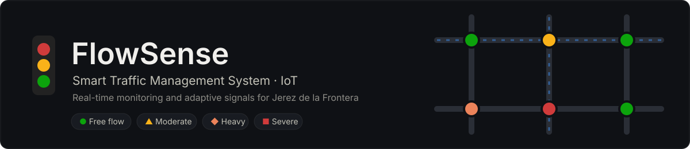
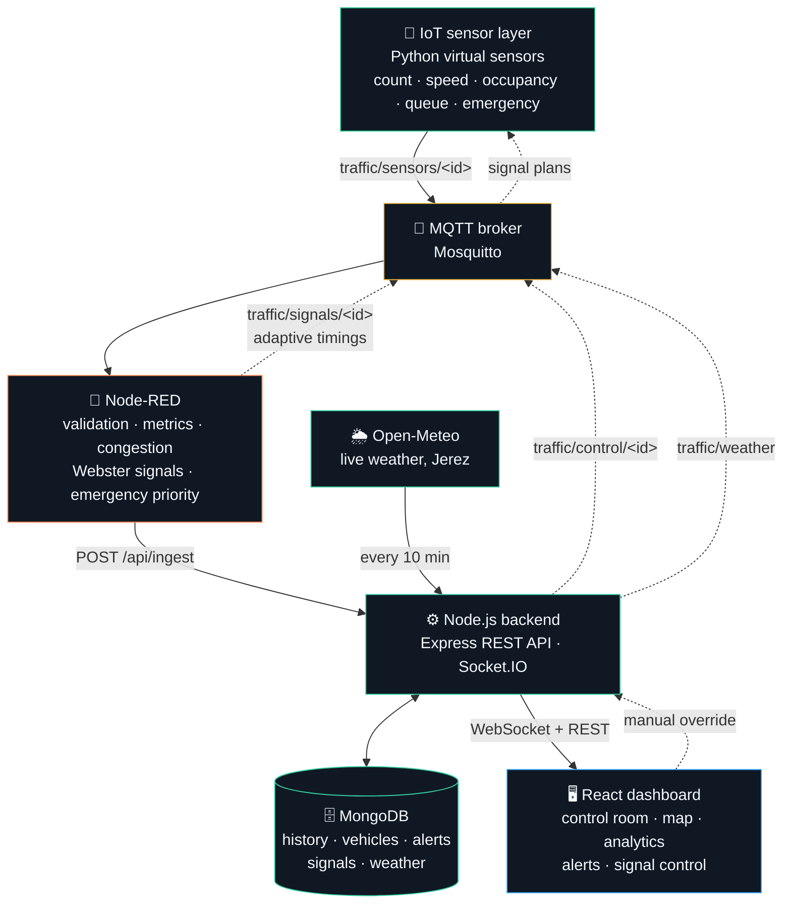
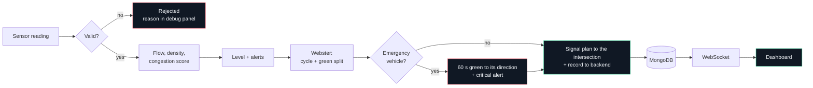
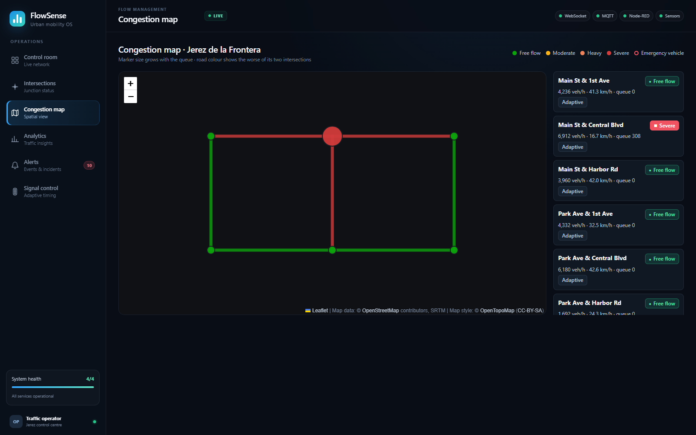
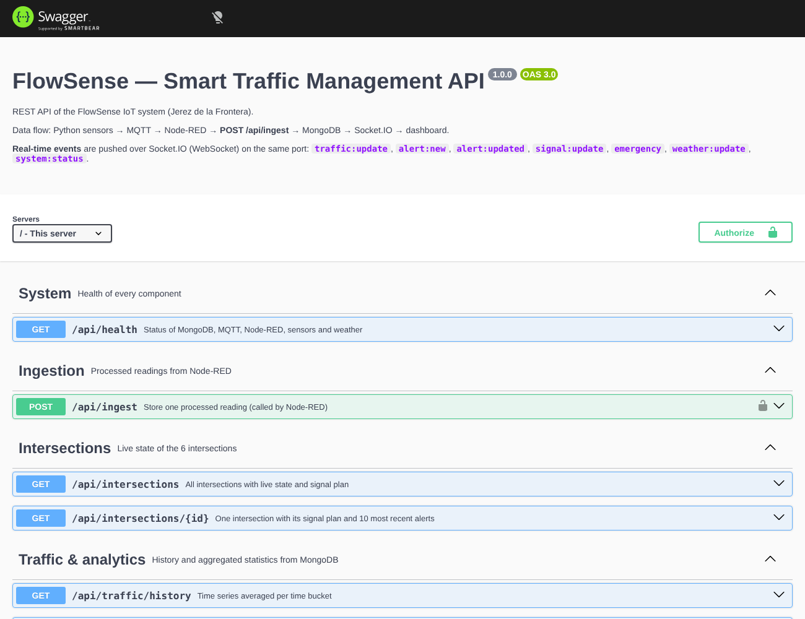

<p align="center">
  
</p>

<p align="center">
  
  
  
  
  
  
  
</p>

<p align="center">
  <a href="#-quick-start">Quick start</a> ·
  <a href="#-architecture">Architecture</a> ·
  <a href="#-dashboard">Dashboard</a> ·
  <a href="#-rest-api">API</a> ·
  <a href="#-results">Results</a> ·
  <a href="#-demo-scenarios">Demo</a> ·
  <a href="#-configuration">Configuration</a>
</p>

---

**FlowSense** watches traffic at six intersections in **Jerez de la Frontera** in real time. It detects congestion
and incidents, adapts the traffic lights on its own, gives green to emergency vehicles, takes the live weather into
account, and shows everything on a control-room dashboard.

<table>
  <tr>
    <td width="33%"><b>📡 Sense</b><br>Virtual sensors report count, speed, occupancy and queue for every approach, every 5 s.</td>
    <td width="33%"><b>🧠 Decide</b><br>Node-RED scores congestion and computes signal timings with Webster's method.</td>
    <td width="33%"><b>🚦 Act</b><br>New timings go back to the intersections over MQTT. Emergency vehicles get green first.</td>
  </tr>
</table>


---

## 🚀 Quick start

> **Requirement:** Docker Desktop running. Nothing else to install.

```bat
docker compose up -d --build
```

On Windows you can also double-click **`start.bat`**: it builds, starts and saves the output to `start.log`.

| Service | URL |
|---|---|
| 🖥️ **Dashboard** | http://localhost:8080 |
| 📘 **API docs (Swagger)** | http://localhost:4000/api/docs (also http://localhost:8080/api/docs) |
| ❤️ Backend health | http://localhost:4000/api/health |
| 🔀 Node-RED editor | http://localhost:1880 |
| 📨 MQTT broker | `localhost:1883` · WebSockets `9001` |
| 🗄️ MongoDB | `mongodb://localhost:27017/smart_traffic` |

Data appears after about **15 seconds**. The simulated clock runs **60× faster** than real time, so a full day,
morning and evening rush hours included, lasts **24 minutes**.

```bat
docker compose down        :: stop
docker compose down -v     :: stop and delete the database
```

> [!TIP]
> Updating from an older version? Run `docker compose down` first, then `docker compose up -d --build`, so the old
> containers are replaced.

---

## 🏗️ Architecture



### How one reading is processed



### Congestion levels

The dashboard always shows a level with its **icon and label**, never colour alone.

| Level | Score | Colour |
|---|---|---|
| ● **Free flow** | < 0.30 |  |
| ▲ **Moderate** | 0.30 – 0.50 |  |
| ◆ **Heavy** | 0.50 – 0.70 |  |
| ■ **Severe** | ≥ 0.70 |  |

Score = 0.45 × occupancy + 0.35 × speed loss + 0.20 × queue pressure (+ 0.10 when there is an incident).

---

## 🧩 Components

<details open>
<summary><b>1 · IoT sensor layer</b> — <code>sensors/simulator.py</code></summary>

<br>

Six intersections (2 streets × 3 avenues), four approaches each (N, S, E, W). For every approach, a reading has the
vehicle count, average speed, occupancy, queue length and an incident flag, plus notable vehicles and emergency
detection.

- **Daily rhythm:** morning peak around 08:15, evening peak around 18:00, quiet nights.
- **Queues:** vehicles arrive at random and leave according to the green time the light gives them.
- **Incidents:** a random capacity drop on one approach, for 30 to 90 simulated minutes.
- **Emergency vehicles:** an ambulance, fire truck or police car approaching from one direction.
- **Closed loop:** listens to `traffic/signals/<id>` (more green → shorter queue) and `traffic/weather`
  (rain, fog or storm → slower traffic).

Run it without a broker to inspect the output:

```bash
python sensors/simulator.py --dry-run   # print one reading
python sensors/simulator.py --day       # print a simulated 24 h summary
```

</details>

<details open>
<summary><b>2 · MQTT topics</b></summary>

<br>

| Topic | From → to | Content |
|---|---|---|
| `traffic/sensors/<id>` | sensors → Node-RED | raw reading |
| `traffic/signals/<id>` *(retained)* | Node-RED → sensors | signal plan |
| `traffic/processed/<id>` *(retained)* | Node-RED → anyone | reading + metrics + level |
| `traffic/alerts/<id>` | Node-RED → anyone | congestion, incident and emergency alerts |
| `traffic/control/<id>` *(retained)* | backend → Node-RED | manual override |
| `traffic/weather` *(retained)* | backend → sensors | current weather condition |
| `traffic/status/<component>` *(retained)* | all | `{ "online": true/false }` |

</details>

<details open>
<summary><b>3 · Node-RED processing</b> — <code>node-red/functions/*.js</code></summary>

<br>

| Node | Logic |
|---|---|
| **Data validation** | rejects an invalid id, empty data, stale (> 5 min) or duplicate readings; clamps out-of-range values |
| **Metrics + congestion** | flow = count × 3600 / window · density = flow / speed / lanes · congestion score and level (see [Congestion levels](#congestion-levels)) · alerts only when the level changes |
| **Signal optimisation** | Webster: C₀ = (1.5 L + 5) / (1 − Y), green split by flow ratio, 10 s minimum green, 40–150 s cycle, smoothed |
| **Emergency priority** | 60 s green to the emergency vehicle's direction, critical alert, back to adaptive once it has passed |
| **Backend routing** | `POST /api/ingest` with the `x-ingest-token` header |
| **Manual override** | applies plans sent from the dashboard until they are released |

To change the logic, edit a file in `node-red/functions/`, then rebuild the flow:

```bash
node node-red/build-flows.js
docker compose up -d --build node-red
```

</details>

<details open>
<summary><b>4 · Backend</b> — <code>backend/src</code></summary>

<br>

**MongoDB collections**

| Collection | Content |
|---|---|
| `intersections` | live state of each intersection |
| `trafficreadings` | reading history |
| `vehiclerecords` | notable and emergency vehicles |
| `alerts` | congestion, incident, emergency and weather alerts |
| `signalconfigs` · `signalhistories` | current signal plan and its history |
| `weatherreadings` | weather history |

Readings, vehicle records and weather readings are deleted automatically after **30 days** (TTL index, set with
`READINGS_TTL_DAYS`).

**Weather:** every 10 minutes the backend reads the current weather in Jerez from
[Open-Meteo](https://open-meteo.com) (free, no API key). It stores it, sends it to the simulator and raises a
city-wide alert for heavy rain, fog or storms.

</details>

---

## 🖥️ Dashboard

React + Vite, served by nginx. Dark "FlowSense 2.0" operations theme with a sidebar menu. The header shows the live status of the **WebSocket**,
**MQTT**, **Node-RED** and **Sensors** connections.

| Page | What you see |
|---|---|
| **Control room** | KPIs (speed, volume, alerts, travel time index), Jerez weather, live map, incident summary, congestion trend, signal performance gauges, throughput, speed per intersection, incident response, network status |
| **Intersections** | one live card per intersection: per-direction data, congestion level, signal phase bar |
| **Congestion map** | dark map of Jerez, roads and intersections coloured by congestion, emergency markers |
| **Analytics** | flow, speed and occupancy over time, congestion per intersection, time per level, table, from 15 min to 24 h |
| **Alerts** | filter, acknowledge one or all, live pop-ups |
| **Signal control** | sliders for north–south and east–west green, back to adaptive, plan history |

| | |
|---|---|
|  |  |
|  |  |
|  |  |

---

## 🔌 REST API

Interactive documentation: **http://localhost:4000/api/docs**. Every endpoint has its parameters, request and
response schemas and a *Try it out* button. Raw spec: `/api/openapi.json` (source: `backend/src/openapi.js`).

| Method | Path | Purpose |
|---|---|---|
| `GET` | `/api/health` | status of MongoDB, MQTT, Node-RED, sensors and weather |
| `POST` | `/api/ingest` | processed reading from Node-RED (needs `x-ingest-token`) |
| `GET` | `/api/intersections` · `/api/intersections/:id` | live state + signal plan |
| `GET` | `/api/traffic/history?minutes=60&bucket=60&intersectionId=` | time series |
| `GET` | `/api/analytics/summary?minutes=60` | KPIs, time per level, per-intersection stats |
| `GET` | `/api/alerts?status=active` | alerts |
| `PATCH` | `/api/alerts/:id/ack` | acknowledge one alert |
| `POST` | `/api/alerts/ack-all` | acknowledge all active alerts |
| `GET` | `/api/vehicles?emergency=true` | vehicle records |
| `GET` | `/api/signals` · `/api/signals/:id/history` | signal plans and their history |
| `PUT` | `/api/signals/:id` | `{ "mode": "manual", "nsGreen": 45, "ewGreen": 30 }` or `{ "mode": "adaptive" }` |
| `GET` | `/api/weather?hours=24` | current Jerez weather + history |
| `POST` | `/api/weather/simulate` | demo: `clear`, `cloudy`, `rain`, `heavy_rain`, `fog`, `storm` |

**WebSocket events (Socket.IO):** `traffic:update` · `alert:new` · `alert:updated` · `alert:bulk` ·
`signal:update` · `emergency` · `weather:update` · `system:status`

---

## 📊 Results

The same simulated evening rush (16:30–20:30), with fixed timings and with FlowSense adaptive signals:

| | Fixed 40 s / 40 s | Adaptive (Webster) | Change |
|---|---|---|---|
| Average queue per intersection | 46 vehicles | **25 vehicles** | **−45 %** |
| Total time spent queueing | 1 106 vehicle-hours | **615 vehicle-hours** | **−44 %** |
| Average speed | 37.1 km/h | **39.6 km/h** | **+7 %** |

---

## 🎬 Demo scenarios

Run these in a Command Prompt while the system is up.

```bat
:: make it rain (or use "Simulate weather" in the weather tile of the dashboard)
curl -X POST http://localhost:4000/api/weather/simulate -H "content-type: application/json" -d "{\"condition\":\"heavy_rain\"}"

:: manual signal plan at INT-003, then back to adaptive (or use the Signal control page)
curl -X PUT http://localhost:4000/api/signals/INT-003 -H "content-type: application/json" -d "{\"mode\":\"manual\",\"nsGreen\":30,\"ewGreen\":70}"
curl -X PUT http://localhost:4000/api/signals/INT-003 -H "content-type: application/json" -d "{\"mode\":\"adaptive\"}"

:: watch the MQTT traffic
docker compose exec mosquitto mosquitto_sub -v -t traffic/alerts/#
docker compose exec mosquitto mosquitto_sub -v -t traffic/signals/#

:: logs
docker compose logs -f sensors
docker compose logs -f backend
```

> [!TIP]
> To see the morning rush straight away, set `START_HOUR: 7.5` for the `sensors` service in `docker-compose.yml`.

---

## ⚙️ Configuration

All settings are environment variables in `docker-compose.yml`.

| Service | Variable | Default | Meaning |
|---|---|---|---|
| sensors | `INTERVAL_SEC` | `5` | real seconds between readings |
| sensors | `SIM_TIME_SCALE` | `60` | simulated seconds per real second |
| sensors | `START_HOUR` | current time | start the simulated clock at a given hour, e.g. `7.5` |
| sensors | `EMERGENCY_PROB` · `INCIDENT_PROB` | `0.01` · `0.0015` | how often emergencies and incidents happen |
| sensors | `WEATHER` | `clear` | weather until the backend sends the real one |
| sensors | `SEED` | random | fixed random seed, for reproducible runs |
| backend | `WEATHER_ENABLED` · `WEATHER_CITY` · `WEATHER_LAT` · `WEATHER_LON` · `WEATHER_INTERVAL_MIN` | Jerez, every 10 min | weather source |
| backend | `READINGS_TTL_DAYS` | `30` | days before old readings are deleted |
| backend | `CORS_ORIGIN` | `*` | origins allowed to call the API |
| backend + node-red | `INGEST_TOKEN` | `dev-ingest-token` | shared secret for `/api/ingest` |

> [!IMPORTANT]
> Change `INGEST_TOKEN` outside a local demo. Put it in a `.env` file next to `docker-compose.yml`:
> `INGEST_TOKEN=your-own-secret`.

---

## 🛠️ Development without Docker

Needs MongoDB and Mosquitto running on `localhost`, Node.js 20+ and Python 3.

```bash
cd backend  && npm install && npm run dev      # API on :4000 (restarts on change)
cd frontend && npm install && npm run dev      # dashboard on :5173, proxies /api and /socket.io to :4000
cd sensors  && pip install -r requirements.txt && python simulator.py
```

For Node-RED, import `node-red/flows.json` with `MQTT_HOST=localhost` and `BACKEND_URL=http://localhost:4000`.

---

## 📁 Project structure

```
FlowSense/
├── docker-compose.yml     all services
├── start.bat              build + start on Windows, output saved to start.log
├── sensors/               Python virtual sensors (simulator.py)
├── mosquitto/             MQTT broker configuration
├── node-red/              flows.json, functions/*.js, build-flows.js
├── backend/               Express API, Socket.IO, Mongoose models, weather service
├── frontend/              React dashboard (Vite) + nginx configuration
└── docs/                  banner, screenshots
```

---

## 🎓 Academic context

| | |
|---|---|
| **Programme** | Máster Universitario en Investigación en Ingeniería de Sistemas y de la Computación (MUIISC) |
| **University** | Universidad de Cádiz (UCA) · Escuela Superior de Ingeniería (ESI) |
| **Itinerary** | *Transformación Digital: Internet de las Cosas y Big Data* |
| **Course** | Internet de las cosas (Internet of Things), practical assignment |
| **Student** | Anass Lamaalam |
| **Academic year** | 2026–2027 |

The master is a one-year official research master (60 ECTS): a common module (R&D projects, research methodology), a
specialisation itinerary and a master's thesis (TFM). FlowSense is the practical work for the IoT course. It covers
the course's main topics end to end: sensing devices, an MQTT publish/subscribe broker, edge processing, a backend
with storage, real-time visualisation, and the evaluation of an adaptive control algorithm.

<details>
<summary><b>Tickets</b></summary>

<br>

| Ticket | Delivered by |
|---|---|
| ST-1 Docker skeleton | `docker-compose.yml`, all Dockerfiles |
| ST-2 – ST-4 Sensors | `sensors/simulator.py` |
| ST-5 – ST-8 Node-RED | `node-red/functions/validate.js`, `process.js`, `signal.js`, `emergency.js` |
| ST-9 – ST-12 Backend | `backend/src/models.js`, `routes.js`, `realtime.js`, `services/ingest.js` |
| ST-13 – ST-17 Dashboard | `frontend/src/pages/*` |
| ST-18 End-to-end testing | full chain checked: sensors → MQTT → Node-RED → API → MongoDB → WebSocket → dashboard |
| ST-19 Documentation | this README, diagrams, screenshots |
| Weather (Open-Meteo, Jerez) | `backend/src/services/weather.js`, `frontend/src/components/WeatherTile.jsx` |

</details>
