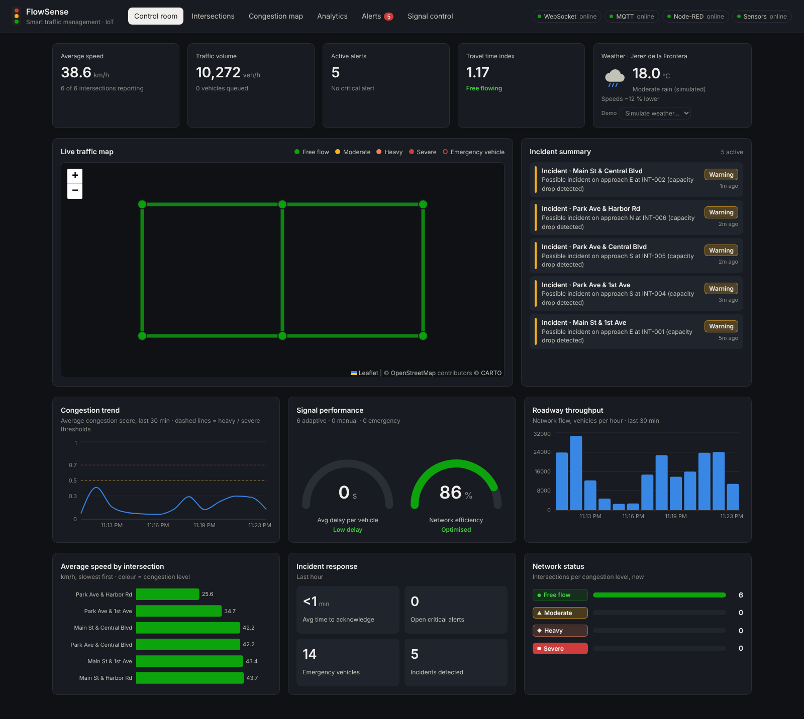
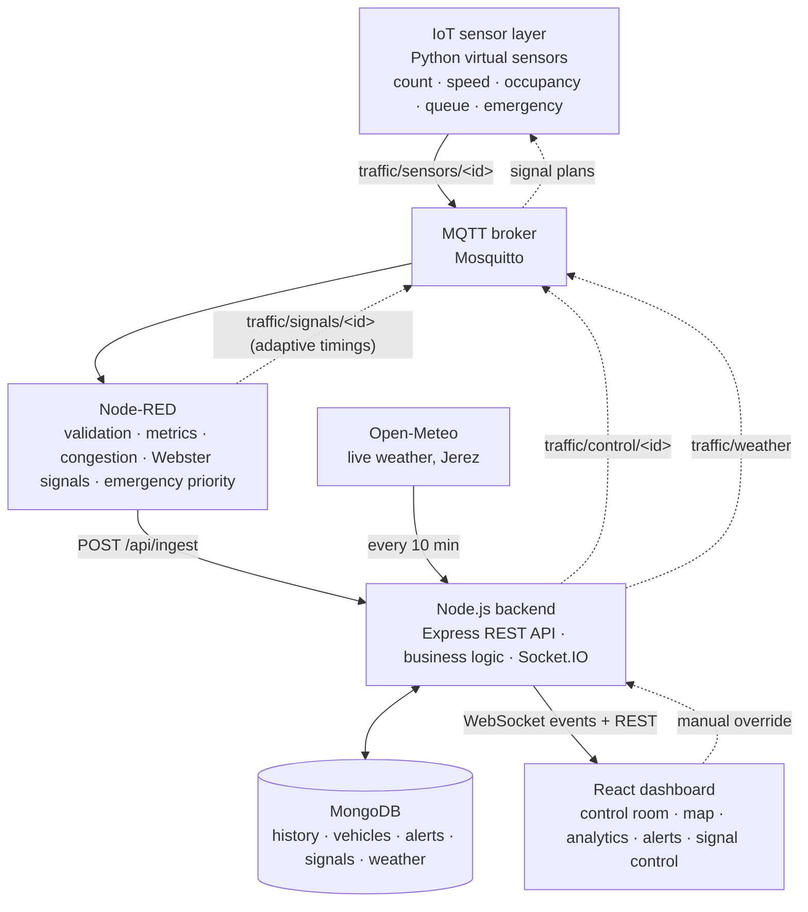
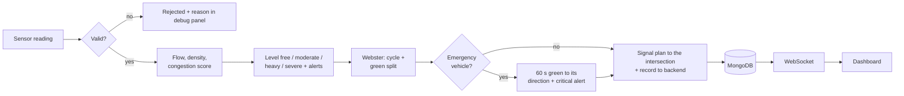
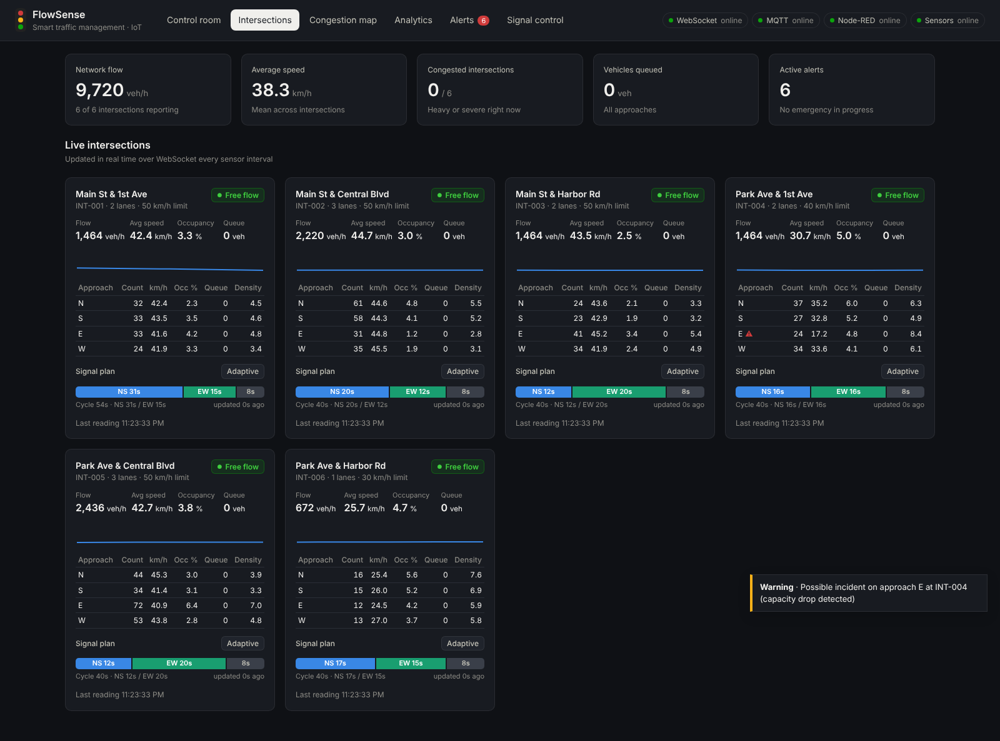
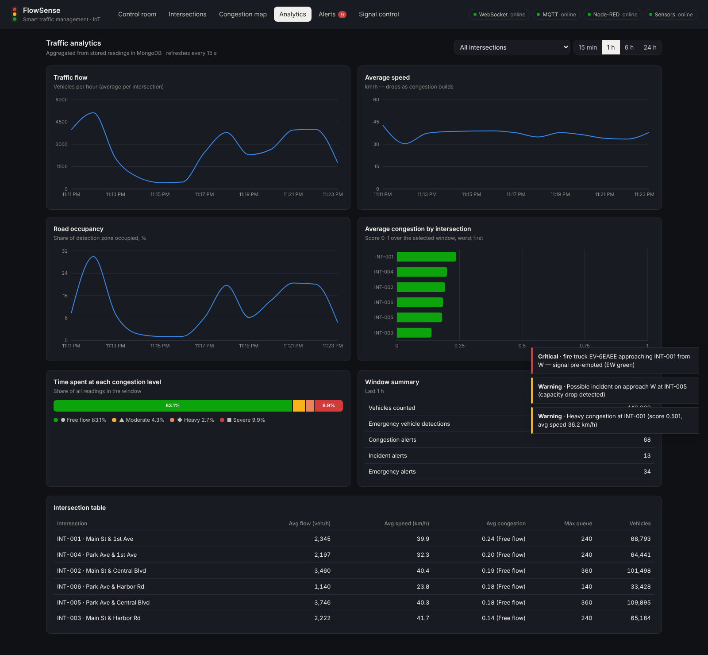
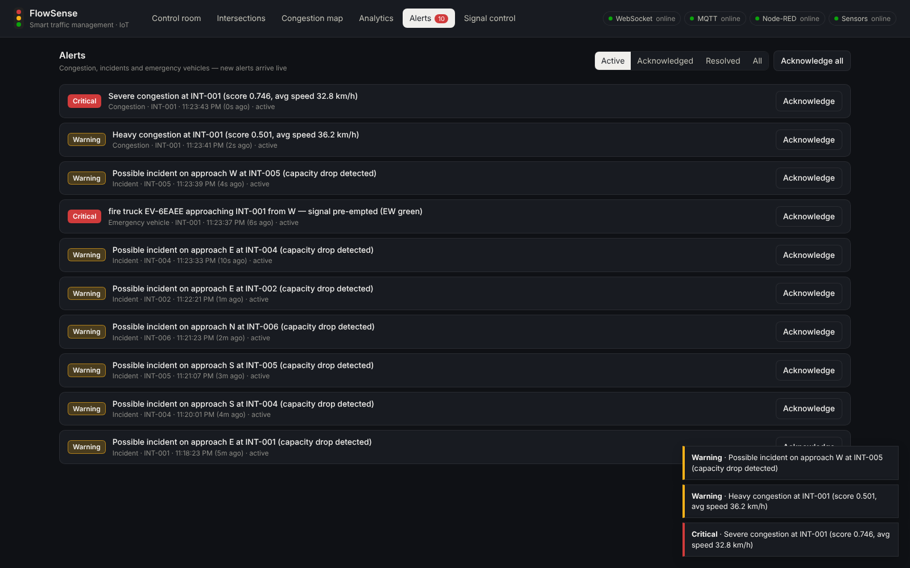
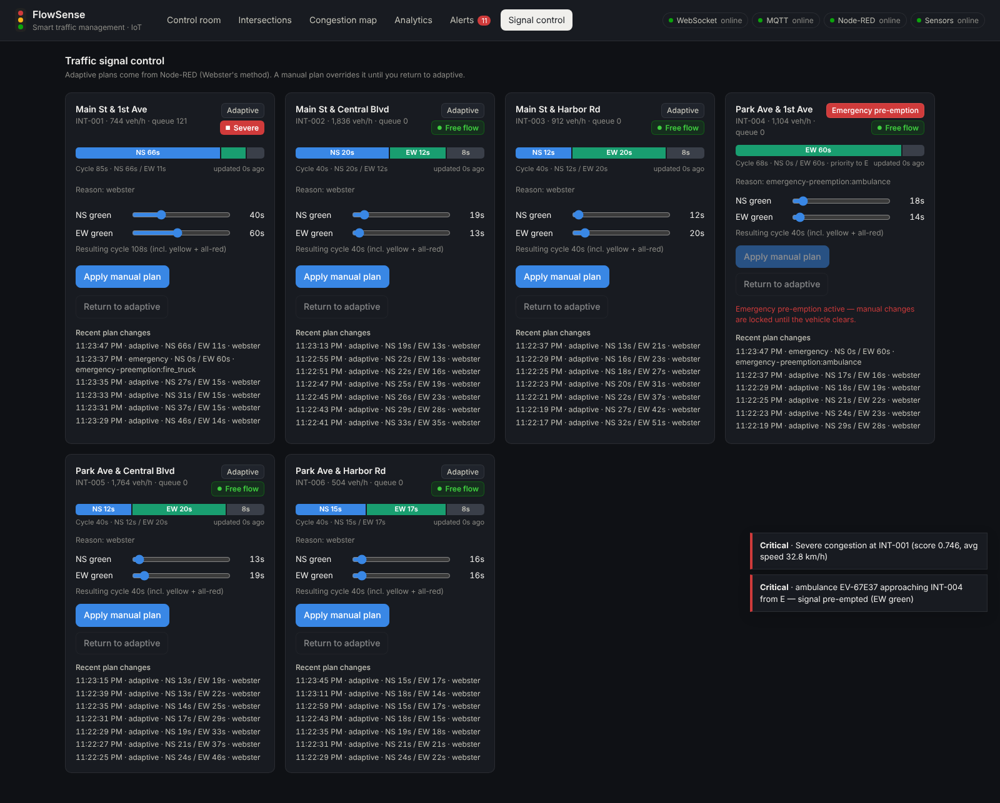

# FlowSense — Smart Traffic Management System (IoT)

FlowSense monitors traffic at six intersections in **Jerez de la Frontera** in real time, detects congestion and
incidents, adapts the traffic lights automatically, gives green to emergency vehicles, takes the live weather into
account, and shows everything on a control-room dashboard.

**Stack:** Python virtual sensors · MQTT (Mosquitto) · Node-RED · Node.js / Express · Socket.IO (WebSocket) · MongoDB · React · Docker



---

## Quick start

Requirement: **Docker Desktop** running. Nothing else to install.

```bat
docker compose up -d --build      :: or double-click start.bat (output saved to start.log)
```

| Service | URL |
|---|---|
| **Dashboard** | http://localhost:8080 |
| Node-RED editor | http://localhost:1880 |
| Backend API | http://localhost:4000/api/health |
| MQTT broker | `localhost:1883` (WebSockets `9001`) |
| MongoDB | `mongodb://localhost:27017/smart_traffic` |

Data appears after ~15 s. The simulated clock runs 60× faster than real time, so a full day (with the morning and
evening rush hours) lasts 24 minutes. Stop with `docker compose down` (add `-v` to also delete the database).

> Updating from an older version: run `docker compose down` first, then `docker compose up -d --build`,
> so the old containers are replaced.

---

## Architecture



### How one reading is processed



---

## Components

### 1. IoT sensor layer — `sensors/simulator.py`

Six intersections (2 streets × 3 avenues), four approaches each (N, S, E, W). Every reading contains, per approach:
vehicle count, average speed, occupancy, queue length and incident flag, plus notable vehicles and emergency detection.

- **Daily rhythm:** morning peak ~08:15, evening peak ~18:00, quiet nights.
- **Queues:** vehicles arrive randomly and leave according to the green time the light gives them.
- **Incidents:** random capacity drop on one approach for 30–90 simulated minutes.
- **Emergency vehicles:** ambulance, fire truck or police approaching from one direction.
- **Closed loop:** listens to `traffic/signals/<id>` (more green → shorter queue) and `traffic/weather`
  (rain / fog / storm → slower traffic).
- `python sensors/simulator.py --day` prints a simulated 24 h summary without any broker.

### 2. MQTT topics

| Topic | From → to | Content |
|---|---|---|
| `traffic/sensors/<id>` | sensors → Node-RED | raw reading |
| `traffic/signals/<id>` (retained) | Node-RED → sensors | signal plan |
| `traffic/processed/<id>` (retained) | Node-RED → anyone | reading + metrics + level |
| `traffic/alerts/<id>` | Node-RED → anyone | congestion / incident / emergency alerts |
| `traffic/control/<id>` (retained) | backend → Node-RED | manual override |
| `traffic/weather` (retained) | backend → sensors | current weather condition |
| `traffic/status/<component>` (retained) | all | `{ "online": true/false }` |

### 3. Node-RED processing — `node-red/functions/*.js`

| Node | Logic |
|---|---|
| **Data validation** | rejects invalid id, empty data, stale (> 5 min) or duplicate readings; clamps out-of-range values |
| **Metrics + congestion** | flow = count × 3600 / window · density = flow / speed / lanes · score = 0.45 × occupancy + 0.35 × speed loss + 0.20 × queue pressure (+0.1 incident) · free < 0.30 ≤ moderate < 0.50 ≤ heavy < 0.70 ≤ severe · alerts only on change |
| **Signal optimization** | Webster: C₀ = (1.5 L + 5) / (1 − Y), green split by flow ratio, 10 s minimum green, 40–150 s cycle, smoothed |
| **Emergency priority** | 60 s green to the emergency vehicle's direction, critical alert, back to adaptive after it passes |
| **Backend routing** | `POST /api/ingest` with the `x-ingest-token` header |
| **Manual override** | applies plans sent from the dashboard until released |

Edit a file in `node-red/functions/`, then `node node-red/build-flows.js` and `docker compose up -d --build node-red`.

### 4. Backend — `backend/src`

**MongoDB collections:** `intersections` (live state), `trafficreadings` (history, 30-day TTL), `vehiclerecords`,
`alerts`, `signalconfigs`, `signalhistories`, `weatherreadings`.

| Method | Path | Purpose |
|---|---|---|
| GET | `/api/health` | status of MongoDB, MQTT, Node-RED, sensors, weather |
| POST | `/api/ingest` | processed reading from Node-RED |
| GET | `/api/intersections`, `/api/intersections/:id` | live state + signal plan |
| GET | `/api/traffic/history?minutes=60&bucket=60&intersectionId=` | time series |
| GET | `/api/analytics/summary?minutes=60` | KPIs, time per level, per-intersection stats |
| GET | `/api/alerts?status=active` · PATCH `/api/alerts/:id/ack` · POST `/api/alerts/ack-all` | alerts |
| GET | `/api/vehicles?emergency=true` | vehicle records |
| GET | `/api/signals`, `/api/signals/:id/history` | signal plans |
| PUT | `/api/signals/:id` | `{ "mode": "manual", "nsGreen": 45, "ewGreen": 30 }` or `{ "mode": "adaptive" }` |
| GET | `/api/weather?hours=24` | current Jerez weather + history |
| POST | `/api/weather/simulate` | demo: `clear`, `cloudy`, `rain`, `heavy_rain`, `fog`, `storm` |

**WebSocket (Socket.IO) events:** `traffic:update`, `alert:new`, `alert:updated`, `signal:update`, `emergency`,
`weather:update`, `system:status`.

**Weather:** every 10 minutes the backend reads the current weather in Jerez from [Open-Meteo](https://open-meteo.com)
(free, no API key), stores it, sends it to the simulator and raises a city-wide alert for heavy rain, fog or storms.

### 5. Dashboard — `frontend/src` (React + Vite, served by nginx)

| Page | Content |
|---|---|
| **Control room** | KPIs (speed, volume, alerts, travel time index), Jerez weather, live map, incident summary, congestion trend, signal performance gauges, throughput, speed per intersection, incident response, network status |
| **Intersections** | one live card per intersection: per-direction data, congestion level, signal phase bar |
| **Congestion map** | dark map of Jerez, roads and intersections coloured by congestion, emergency markers |
| **Analytics** | flow / speed / occupancy over time, congestion per intersection, time per level, table — 15 min to 24 h |
| **Alerts** | filter, acknowledge one or all, live pop-ups |
| **Signal control** | sliders for north–south / east–west green, return to adaptive, plan history |

| | |
|---|---|
|  |  |
|  |  |

---

## Results

Same simulated evening rush (16:30–20:30), fixed timings vs FlowSense adaptive signals:

| | Fixed 40 s / 40 s | Adaptive (Webster) |
|---|---|---|
| Average queue per intersection | 46 vehicles | **25 vehicles (−45 %)** |
| Total time spent queueing | 1 106 vehicle-hours | **615 vehicle-hours (−44 %)** |
| Average speed | 37.1 km/h | **39.6 km/h** |

---

## Demo scenarios (Command Prompt)

```bat
:: make it rain (or use "Simulate weather" in the dashboard weather tile)
curl -X POST http://localhost:4000/api/weather/simulate -H "content-type: application/json" -d "{\"condition\":\"heavy_rain\"}"

:: manual traffic light plan at INT-003, then back to adaptive (or use the Signal control page)
curl -X PUT http://localhost:4000/api/signals/INT-003 -H "content-type: application/json" -d "{\"mode\":\"manual\",\"nsGreen\":30,\"ewGreen\":70}"
curl -X PUT http://localhost:4000/api/signals/INT-003 -H "content-type: application/json" -d "{\"mode\":\"adaptive\"}"

:: watch MQTT traffic
docker compose exec mosquitto mosquitto_sub -v -t traffic/alerts/#
docker compose exec mosquitto mosquitto_sub -v -t traffic/signals/#

:: logs
docker compose logs -f sensors
docker compose logs -f backend
```

---

## Configuration (`docker-compose.yml`)

| Service | Variable | Default | Meaning |
|---|---|---|---|
| sensors | `INTERVAL_SEC` | 5 | real seconds between readings |
| sensors | `SIM_TIME_SCALE` | 60 | simulated seconds per real second |
| sensors | `START_HOUR` | now | start the simulated clock at a given hour, e.g. `7.5` |
| sensors | `EMERGENCY_PROB` / `INCIDENT_PROB` | 0.01 / 0.0015 | event frequency |
| sensors | `WEATHER` | clear | weather until the backend sends the real one |
| backend | `WEATHER_ENABLED`, `WEATHER_CITY`, `WEATHER_LAT`, `WEATHER_LON`, `WEATHER_INTERVAL_MIN` | Jerez, 10 min | weather source |
| backend + node-red | `INGEST_TOKEN` | dev-ingest-token | shared secret for `/api/ingest` — change it in production (`.env`) |

---

## Project structure

```
├── docker-compose.yml        all services
├── start.bat                 build + start, output saved to start.log
├── sensors/                  Python virtual sensors (simulator.py)
├── mosquitto/                MQTT broker config
├── node-red/                 flows.json, functions/*.js, build-flows.js
├── backend/                  Express API, Socket.IO, Mongoose models, weather service
├── frontend/                 React dashboard (Vite) + nginx config
└── docs/screenshots/         dashboard screenshots
```

## Development without Docker

```bash
# needs MongoDB and Mosquitto on localhost
cd backend  && npm install && npm run dev          # :4000
cd frontend && npm install && npm run dev          # :5173 (proxies /api and /socket.io to :4000)
cd sensors  && pip install -r requirements.txt && python simulator.py
# Node-RED: import node-red/flows.json with env MQTT_HOST=localhost, BACKEND_URL=http://localhost:4000
```

## Tickets

| Ticket | Delivered by |
|---|---|
| ST-1 Docker skeleton | `docker-compose.yml`, all Dockerfiles |
| ST-2 – ST-4 Sensors | `sensors/simulator.py` |
| ST-5 – ST-8 Node-RED | `node-red/functions/validate.js`, `process.js`, `signal.js`, `emergency.js` |
| ST-9 – ST-12 Backend | `backend/src/models.js`, `routes.js`, `realtime.js`, `services/ingest.js` |
| ST-13 – ST-17 Dashboard | `frontend/src/pages/*` |
| ST-18 End-to-end testing | full chain verified: sensors → MQTT → Node-RED → API → MongoDB → WebSocket → dashboard |
| ST-19 Documentation | this README, diagrams, screenshots |
| Weather (Open-Meteo, Jerez) | `backend/src/services/weather.js`, `frontend/src/components/WeatherTile.jsx` |
